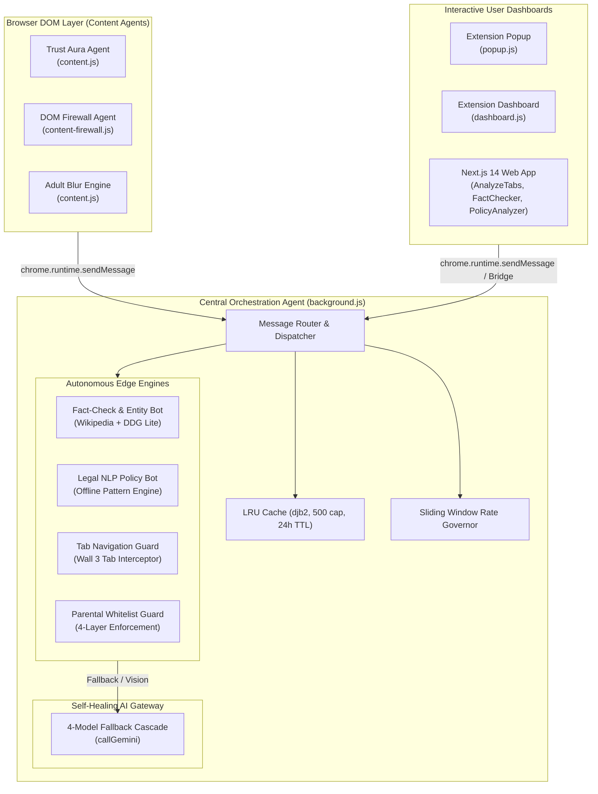
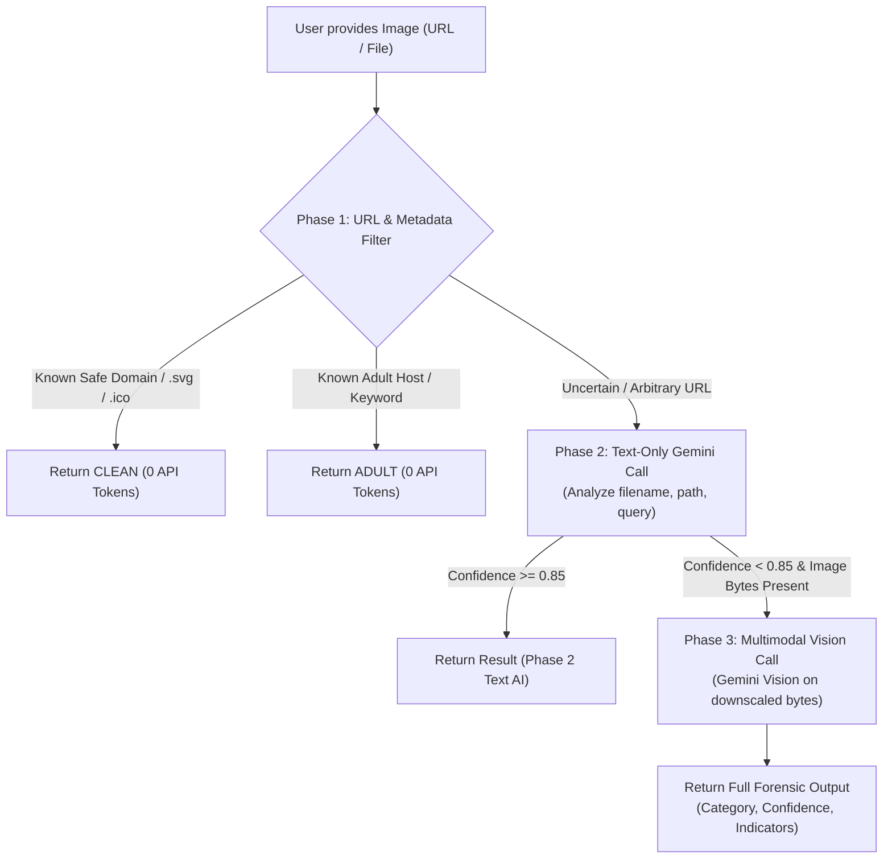

# 🛡️ Ambient Shield — Agent Architecture & Technical Specification

> **Ambient Shield** is an edge-native, agentic digital guardian operating inside the browser. It autonomously detects misinformation, demystifies predatory privacy policies, inspects images for deepfakes, and enforces active content firewalls — all designed with an **ambient, zero-friction, privacy-first paradigm**.

---

## 📑 Table of Contents

1. [Executive Summary & Agent Philosophy](#1-executive-summary--agent-philosophy)
2. [Agent Ecosystem & System Architecture](#2-agent-ecosystem--system-architecture)
3. [Core Autonomous Agents & Subsystems](#3-core-autonomous-agents--subsystems)
   - [Agent 1: Trust Aura Social Feed Scanner & Classifier](#agent-1-trust-aura-social-feed-scanner--classifier)
   - [Agent 2: Entity-Aware Fact-Checking & Verification Agent](#agent-2-entity-aware-fact-checking--verification-agent)
   - [Agent 3: Offline Privacy Policy Legal Analyst](#agent-3-offline-privacy-policy-legal-analyst)
   - [Agent 4: Forensic Image & Deepfake Analysis Agent](#agent-4-forensic-image--deepfake-analysis-agent)
   - [Agent 5: Content Firewall & Threat Interceptor](#agent-5-content-firewall--threat-interceptor)
   - [Agent 6: Parental & Work-Mode Whitelist Enforcement Agent](#agent-6-parental--work-mode-whitelist-enforcement-agent)
4. [AI Model Cascade & Self-Healing Gateway](#4-ai-model-cascade--self-healing-gateway)
5. [In-Memory Caching, Hashing & Rate Limiting](#5-in-memory-caching-hashing--rate-limiting)
6. [Extension Message Bus & Communication Protocol](#6-extension-message-bus--communication-protocol)
7. [Frontend Dashboards & Hybrid Bridge Architecture](#7-frontend-dashboards--hybrid-bridge-architecture)
8. [Build, Packaging & MV3 Security Hardening](#8-build-packaging--mv3-security-hardening)
9. [Summary of File Responsibilities](#9-summary-of-file-responsibilities)

---

## 1. Executive Summary & Agent Philosophy

Traditional web protection relies on intrusive modal alerts, aggressive blocking that disrupts reading flow, and cloud proxies that harvest user browsing history. 

**Ambient Shield introduces the Ambient Agent Paradigm:**
- **Zero Interruption:** Content is never blocked or obscured unless it is strictly classified as harmful. Instead, subtle, non-intrusive glowing visual cues (*Trust Aura*) ambiently signal information credibility.
- **Edge-First Intelligence:** Agent logic executes directly in the browser runtime (Chrome Manifest V3 Service Worker and isolated content scripts). Sensitive privacy policy evaluations and initial fact-checking checks run **100% locally with zero cloud API calls**.
- **Autonomous Multi-Tier Triage:** Expensive AI operations (multimodal vision, complex reasoning) are guarded by fast pre-filtering, regex heuristics, and lightweight search bots, minimizing latency and compute cost.

```
┌────────────────────────────────────────────────────────────────────────┐
│                        Ambient Agent Paradigm                          │
│                                                                        │
│   Fast Heuristics    →    Offline Search/Rules    →    Cloud AI        │
│   (Instant, 0ms)           (Zero API Cost, Edge)        (4-Model Cascade)│
│                                                                        │
│   • Regex Pre-Filter       • MediaWiki API               • gemini-2.0-flash │
│   • Domain Whitelists      • DuckDuckGo Lite             • gemini-1.5-pro  │
│   • Static Rulesets        • Local Legal NLP             • gemini-1.5-flash│
└────────────────────────────────────────────────────────────────────────┘
```

---

## 2. Agent Ecosystem & System Architecture

Ambient Shield operates as a decentralized multi-agent system divided into three primary execution domains: **DOM Content Agents**, the **Central Service Worker Agent**, and the **Interactive Agent Dashboards**.



---

## 3. Core Autonomous Agents & Subsystems

### Agent 1: Trust Aura Social Feed Scanner & Classifier
* **Primary Implementation:** [`extension/content.js`](file:///f:/AOT/Agentic%20Chase/ambient-Shield/extension/content.js), [`extension/background.js`](file:///f:/AOT/Agentic%20Chase/ambient-Shield/extension/background.js)
* **Goal:** Continuously inspect social media feeds and ambiently wrap posts and sponsored advertisements in colored halo glows without altering layout or breaking site styling.

#### How It Works:
1. **Dynamic Feed Detection:** Uses a `MutationObserver` on `document.body` connected to a requestAnimationFrame debounce loop (`scheduleRescan()`) to observe dynamically loaded posts during infinite scrolling.
2. **Platform Adapters:** Maintains dedicated DOM selector rules and ad-detection heuristics across:
   - **X / Twitter:** `article[data-testid="tweet"]`, checking for `[data-testid="promotedIndicator"]`.
   - **LinkedIn:** `div[data-urn*="urn:li:activity"]`, `div[data-urn*="urn:li:sponsoredUpdate"]`, detecting "Promoted" spans.
   - **Facebook:** `div[data-pagelet*="FeedUnit"]`, `div[role="article"]`, matching `aria-label="Sponsored"`.
   - **Instagram:** `article[role="presentation"]`, scanning for sponsored indicators.
   - **Reddit:** `shreddit-post`, detecting `shreddit-ad-post`.
   - **YouTube:** `ytd-rich-item-renderer`, checking for `ytd-ad-slot-renderer`.
   - **TikTok:** `div[class*="DivItemContainerV2"]`.
3. **Internal Concurrency Control:** Employs an internal queue with `MAX_CONCURRENT = 2` to prevent browser thread saturation while browsing high-density feeds.
4. **Multi-Stage Classification:**
   - **Tier 1 (Fast Regex Pre-Filter):** Evaluates text against sensationalist phrases (`/you won't believe/i`, `/doctors? hate (this|him|her)/i`, `/guaranteed (income|returns)/i`, `/secret (cure|remedy)/i`) and checks for excessive capitalization (>50% uppercase words). If flagged, immediately assigns `danger` or `caution`.
   - **Tier 2 (Entity-Aware Web Verification):** If Tier 1 passes, sends message `action: "TRUST_AURA"` to `background.js`. The background agent calls `deepSearchWeb()`, extracting live context from Wikipedia and DuckDuckGo to determine whether the claim is confirmed or debunked.
5. **Non-Destructive Aura Rendering:**
   - Injects a dedicated absolute child container (`.ambient-aura-overlay`) with `position: relative` applied to the post element.
   - Avoids clipping issues with `overflow: hidden` containers.
   - Appends an animated status badge:
     - 🟢 **Safe:** "Verified" / "Ad Verified" (`#3ecf8e`)
     - 🟡 **Caution:** "Take a 2nd Look" / "Ad — Check Source" (`#f5a623`)
     - 🔴 **Danger:** "Misinformation" / "Ad — Likely False" (`#ff4d6d`)

---

### Agent 2: Entity-Aware Fact-Checking & Verification Agent
* **Primary Implementation:** [`extension/background.js`](file:///f:/AOT/Agentic%20Chase/ambient-Shield/extension/background.js#L524-L822), [`components/analyze/FactChecker.tsx`](file:///f:/AOT/Agentic%20Chase/ambient-Shield/components/analyze/FactChecker.tsx)
* **Goal:** Verify arbitrary text assertions, breaking news, and political election claims without requiring external AI API keys or third-party paid fact-checking services.

```
                    ┌────────────────────────┐
                    │      Input Claim       │
                    └───────────┬────────────┘
                                │
                    ┌───────────▼────────────┐
                    │    extractEntities()   │
                    │ (Party, Region, Year)  │
                    └───────────┬────────────┘
                                │
                    ┌───────────▼────────────┐
                    │ Time Paradox Detector  │──── Claim Year > Current Year?
                    └───────────┬────────────┘     └──► [FALSE: Time Paradox]
                                │ (Valid time)
               ┌────────────────┴────────────────┐
               │                                 │
     ┌─────────▼──────────┐           ┌──────────▼──────────┐
     │  Wikipedia Search  │           │ DuckDuckGo Lite &   │
     │  & Extract API     │           │ Dedicated Debunkers │
     └─────────┬──────────┘           └──────────┬──────────┘
               │                                 │
               └────────────────┬────────────────┘
                                │
                    ┌───────────▼────────────┐
                    │  analyzeFindings()     │
                    │ Entity Winner Check    │
                    └───────────┬────────────┘
                                │
        ┌───────────────────────┼───────────────────────┐
        ▼                       ▼                       ▼
  [Claimed Winner         [Rival Winner           [Sentiment
    Confirmed]              Detected]              Fallback]
     Score: 92               Score: 5             Score: 10-90
    Level: SAFE            Level: DANGER          Level: Dynamic
```

#### Detailed Agent Pipeline:
1. **Entity Extraction (`extractEntities`):**
   - Parses political parties via multi-alias regex dictionaries (e.g., TMC/Mamata Banerjee, BJP/Modi, Congress/INC/Rahul Gandhi, AAP/Kejriwal, Samajwadi Party, CPI(M), DMK, AIADMK, etc.).
   - Recognizes state and city geographic entities (West Bengal, Uttar Pradesh, Bihar, Delhi, Maharashtra, Tamil Nadu, Karnataka, etc.).
   - Extracts target years (`/\b(20\d{2})\b/`) and outcome intents (win vs. loss verbs).
2. **Temporal Anomaly / Time Paradox Detection:**
   - Detects claims describing events as already concluded when the target year is in the future relative to the host system clock:
     $$\text{claimedYear} > \text{currentYear} \land \text{isPastTense}$$
   - Instantly returns `FALSE` with a credibility score of `0` ("Time Paradox: This event has NOT happened yet").
3. **Multi-Source Retrieval Bot (`deepSearchWeb`):**
   - **Source 1 (Wikipedia API):** Constructs targeted queries (`"${year} ${location} Legislative Assembly election"`), searches via `en.wikipedia.org/w/api.php?action=query&list=search`, and extracts 10 clean sentences of article intro using `prop=extracts&exintro&explaintext`.
   - **Source 2 (DuckDuckGo Lite):** Performs a lightweight headless POST to `lite.duckduckgo.com/lite/` for recent news coverage.
   - **Source 3 (Fact-Check Aggregator):** Queries DuckDuckGo restricted to verified debunking repositories (`site:snopes.com OR site:reuters.com OR site:apnews.com OR site:factcheck.org`).
4. **Winner Cross-Verification Logic:**
   - Cross-references the claimed winner with the actual winner cited in Wikipedia text. If a rival entity is documented as winning the mandate, the agent marks the claim `FALSE` (`credibilityScore: 5`), explains the mismatch, and cites the Wikipedia URL.
   - If verified, outputs `TRUE` (`credibilityScore: 92`).
   - If ambiguous, invokes a sentiment frequency model evaluating positive confirmation terms vs. debunking lexicon (`"debunked"`, `"hoax"`, `"misleading"`).

---

### Agent 3: Offline Privacy Policy Legal Analyst
* **Primary Implementation:** [`extension/background.js`](file:///f:/AOT/Agentic%20Chase/ambient-Shield/extension/background.js#L351-L518), [`components/analyze/PolicyAnalyzer.tsx`](file:///f:/AOT/Agentic%20Chase/ambient-Shield/components/analyze/PolicyAnalyzer.tsx)
* **Goal:** Condense 50-page legal terms of service into actionable risk insights, privacy rights, and opt-out directives directly inside the browser sandbox.

#### How It Works:
1. **Automated Discovery & Scraping:**
   - **Pre-mapped Registry (`PRIVACY_POLICY_MAP`):** Holds verified canonical policy endpoints for 25+ top platforms (LinkedIn, Twitter/X, Facebook, Instagram, Google, YouTube, Reddit, TikTok, Amazon, Netflix, Apple, GitHub, Discord, PayPal, Airbnb, Spotify, etc.).
   - **Context-Menu / DOM Scraping:** For unknown domains, scans the DOM for high-priority semantic containers (`main`, `article`, `[role="main"]`, `.privacy-policy`, `#privacy`), cleans raw HTML into plain text via `stripHtml()`, and buffers the top 12,000 characters.
2. **Local Natural Language Heuristic Engine (`analyzePolicyLocal`):**
   - **Data Collection Profiler:** Detects references to IP address, GPS/location tracking, device hardware fingerprints, cross-site cookies/beacons, address book harvesting, and biometric facial/voice data.
   - **Data Sharing Auditor:** Checks for disclosures to third-party ad networks, corporate subsidiaries, cloud vendors, law enforcement subpoenas, and corporate asset acquisitions.
   - **Red Flag Identifier:**
     - Explicit data sale rights (`"sell your personal information"` $\rightarrow$ $+3$ Risk Points).
     - Binding arbitration & class action waiver (`"class action waiver"` $\rightarrow$ $+2$ Risk Points).
     - Cross-site tracker tracking across third-party websites ($\rightarrow$ $+2$ Risk Points).
     - Indefinite retention terms ($\rightarrow$ $+1$ Risk Point).
     - Refusal to respect "Do Not Track" browser headers ($\rightarrow$ $+1$ Risk Point).
   - **User Rights & Opt-out Extractor:**
     - Identifies GDPR rights (Right to erasure, right to access).
     - Detects CCPA/California opt-out provisions and directs users to footer links ("Do Not Sell My Personal Information").
3. **Verdict Generation:**
   - Computes normalized `riskScore` (1–10).
   - Assigns categorizations:
     - `DANGER` (Score $\ge 7$)
     - `CAUTION` (Score $4 - 6$)
     - `SAFE` (Score $1 - 3$)

---

### Agent 4: Forensic Image & Deepfake Analysis Agent
* **Primary Implementation:** [`extension/background.js`](file:///f:/AOT/Agentic%20Chase/ambient-Shield/extension/background.js#L828-L879), [`extension/dashboard.js`](file:///f:/AOT/Agentic%20Chase/ambient-Shield/extension/dashboard.js#L404-L638), [`components/analyze/ImageAnalyzer.tsx`](file:///f:/AOT/Agentic%20Chase/ambient-Shield/components/analyze/ImageAnalyzer.tsx)
* **Goal:** Detect generative AI synthetic media, face-swaps, deepfakes, adult imagery, and violent content while preserving API bandwidth through a 3-phase triage funnel.



#### Detailed Execution Phases:
1. **Phase 1 (Zero-Cost Heuristics):**
   - Matches URLs against a trusted domains list (`youtube.com`, `wikipedia.org`, `github.com`, `wikimedia.org`).
   - Identifies non-photographic asset types (`.svg`, `.ico`, `.gif`).
   - Flags obvious adult paths (`ADULT_URL_KW`).
2. **Phase 2 (Text-Only AI Analysis):**
   - Evaluates URL structure, parent page domain, and filename using Gemini with JSON formatting enforcement.
   - If confidence reaches $\ge 0.85$ or if raw image bytes are unavailable, terminates early and returns without uploading image tokens.
3. **Phase 3 (Multimodal Vision Forensic Inspection):**
   - Triggered only when Phase 2 is inconclusive and binary image data is present.
   - Client pre-processing in `dashboard.js`: Resizes images exceeding 2048px via HTML5 Canvas and compresses output to JPEG to protect against browser memory exhaustion.
   - Transmits base64 payload to Gemini Vision.
   - Structured JSON output format:
     ```json
     {
       "category": "CLEAN" | "VIOLENCE" | "DEEPFAKE" | "ADULT" | "ADULT_AD" | "EDUCATIONAL",
       "confidence": 0.95,
       "reason": "Synthetic facial artifacts and unnatural lighting inconsistent with camera lens",
       "shouldBlock": false,
       "indicators": ["Facial boundary blurring", "Pupil geometry distortion"]
     }
     ```

---

### Agent 5: Content Firewall & Threat Interceptor
* **Primary Implementation:** [`extension/block-rules.json`](file:///f:/AOT/Agentic%20Chase/ambient-Shield/extension/block-rules.json), [`extension/content-firewall.js`](file:///f:/AOT/Agentic%20Chase/ambient-Shield/extension/content-firewall.js), [`extension/background.js`](file:///f:/AOT/Agentic%20Chase/ambient-Shield/extension/background.js#L26-L143)
* **Goal:** Completely intercept and block explicit adult domains and predatory content using an unbypassable, triple-layer defense shield.

| Layer | Component | Mechanism | Speed / Timing |
|---|---|---|---|
| **Wall 1** | Chrome `declarativeNetRequest` | 70+ regex rules in `block-rules.json` that terminate network sockets at the browser network stack. | Pre-network (0ms latency, zero bytes downloaded) |
| **Wall 2** | `content-firewall.js` | Injected at `document_start`. Scans `window.location.href`, URL queries, and search engines (Google, Bing, DDG, YouTube). | Pre-rendering (prevents DOM paint) |
| **Wall 3** | `background.js` Tab Watcher | Listens to `chrome.tabs.onUpdated` and script-injects an unbypassable full-screen overlay if an adult URL fragment is detected. | Real-time navigation watchdog |

#### Anti-Tamper Protections:
- **Mutation Guard:** If the user attempts to delete `#ambient-shield-firewall` via browser developer tools, a `MutationObserver` immediately re-appends the firewall dialog to `document.documentElement`.
- **Keyboard Shortcut Interception:** Intercepts and suppresses `F12`, `Escape`, `Ctrl+Shift+I`, `Ctrl+Shift+J`, `Ctrl+Shift+C`, `Ctrl+Shift+K`, and `Ctrl+U`.
- **Context Menu Suppression:** Blocks right-click "Inspect Element" on blocked pages.

---

### Agent 6: Parental & Work-Mode Whitelist Enforcement Agent
* **Primary Implementation:** [`extension/background.js`](file:///f:/AOT/Agentic%20Chase/ambient-Shield/extension/background.js#L1026-L1123), [`extension/popup.js`](file:///f:/AOT/Agentic%20Chase/ambient-Shield/extension/popup.js#L246-L430), [`extension/blocked.html`](file:///f:/AOT/Agentic%20Chase/ambient-Shield/extension/blocked.html)
* **Goal:** Restrict browsing strictly to an approved whitelist of domains (for focused study, office productivity, or child safety) guarded by a master PIN (`123456`).

#### 4-Layer Enforcement Strategy:
1. **Layer 1 (Immediate Tab Sweep):** When Parental Mode is enabled, the agent queries all open tabs (`chrome.tabs.query({})`) and immediately redirects any non-whitelisted tab to `blocked.html`.
2. **Layer 2 (Pre-Navigation Filter):** Utilizes `chrome.webNavigation.onBeforeNavigate` to abort unauthorized top-level requests before connection initialization.
3. **Layer 3 (Lifecycle Safety Net):** Watches `chrome.tabs.onUpdated` for single-page application navigation (HTML5 `history.pushState`).
4. **Layer 4 (Focus-Switch Audit):** Listens to `chrome.tabs.onActivated` so that switching back to an existing tab instantly forces a compliance verification.

---

## 4. AI Model Cascade & Self-Healing Gateway

* **Implementation:** [`extension/background.js`](file:///f:/AOT/Agentic%20Chase/ambient-Shield/extension/background.js#L226-L335), [`lib/ai.ts`](file:///f:/AOT/Agentic%20Chase/ambient-Shield/lib/ai.ts)

AI API calls are fragile in production environments due to regional restrictions, deprecations, rate limits (`429`), and server overload (`503`). Ambient Shield addresses this with an autonomous **Self-Healing Model Cascade**.

### Cascade Order & Routing Matrix:

```
[Primary Attempt: gemini-2.0-flash]
       │
       ├── 404 / 503 / 429? ──► [Fallback 1: gemini-1.5-pro]
                                       │
                                       ├── 404 / 503 / 429? ──► [Fallback 2: gemini-1.5-flash]
                                                                       │
                                                                       ├── 404 / 503 / 429? ──► [Fallback 3: gemini-1.5-flash-8b / 002]
```

### Self-Healing Mechanisms:
1. **Dual Endpoint Negotiation:** For every model, the gateway tests both the `v1beta` and `v1` REST API versions (`https://generativelanguage.googleapis.com/{apiVersion}/models/{model}:generateContent`).
2. **Exponential Backoff:** Retries transient failures with graduated delays ($1000\text{ms} \rightarrow 3000\text{ms}$).
3. **Hard Timeout Protection:** Enforces a 60-second execution deadline via `AbortController` to prevent background service worker stalls.
4. **Zero-Thinking Configuration:** Explicitly sets `thinkingBudget: 0` to prevent unpredictable 60s+ thinking hangs on Gemini 2.0 reasoning variants.
5. **Robust JSON Sanitization:** Automatically strips markdown code fences (```` ```json ````) and uses regex extraction (`/\{[\s\S]*\}/`) to handle conversational introductory text from the model.

---

## 5. In-Memory Caching, Hashing & Rate Limiting

### Deterministic Hashing:
- **Extension Runtime:** Implements the ultra-fast `djb2` 32-bit bitwise hash function (`(h * 33) ^ charCode`) to compute string keys for all web claims, post text, and URLs.
- **Next.js Web Environment:** Utilizes Node.js `crypto.createHash("sha256")` via [`lib/hash.ts`](file:///f:/AOT/Agentic%20Chase/ambient-Shield/lib/hash.ts) and [`lib/cache.ts`](file:///f:/AOT/Agentic%20Chase/ambient-Shield/lib/cache.ts).

### LRU In-Memory Cache:
- **Capacity:** Fixed upper bound of 500 entries.
- **Eviction Policy:** Least-Recently-Used (LRU). When the store exceeds 500 entries, the oldest key is pruned:
  ```js
  if (resultCache.size >= 500) resultCache.delete(resultCache.keys().next().value);
  ```
- **TTL (Time to Live):** 24-hour expiration window (`86,400,000` ms). Expired records are lazily dropped on query.

### Dual Rate Limiter:
- **Extension Rate Governor:** 15 requests per minute, 100 requests per day (hackathon limits). Provides `dailyRemaining()` counters to the user interface.
- **Web App Governor ([`lib/rate-limit.ts`](file:///f:/AOT/Agentic%20Chase/ambient-Shield/lib/rate-limit.ts)):** Multi-tiered limits tracking per-IP minute limits (8 req), per-IP daily limits (30 req), and a global safety cap (800 req/day).

---

## 6. Extension Message Bus & Communication Protocol

All extension components communicate across an asynchronous message bus handled by `chrome.runtime.onMessage.addListener` in [`extension/background.js`](file:///f:/AOT/Agentic%20Chase/ambient-Shield/extension/background.js#L929-L1023).

| Message Action | Source | Payload | Destination Handler | Description |
|---|---|---|---|---|
| `TRUST_AURA` | `content.js` | `{ text, isAd }` | `handleTrustAura()` | Scans feed post or ad, cross-references web, returns `{ level, reason }` |
| `SCAN_POLICY` | Popup / Dashboard / Next.js | `{ url, urls, siteName, text }` | `handlePolicy()` | Scrapes & analyzes privacy text via offline legal heuristic engine |
| `SCAN_FACT` | Popup / Dashboard / Next.js | `{ text }` | `handleFact()` | Entity extraction & multi-source web verification |
| `SCAN_IMAGE` | Dashboard / Next.js | `{ imageUrl, imageData }` | `handleImage()` | Runs 3-phase deepfake/safety evaluation pipeline |
| `GEMINI_GENERATE` | Dashboard | `{ prompt, imageBase64, imageMime }` | `callGemini()` | Direct raw invocation through the resilient model cascade |
| `FETCH_IMAGE_BASE64`| Dashboard | `{ url }` | Background fetcher | Bypasses CORS by fetching image bytes inside the background worker |
| `PARENTAL_MODE_ON` | Popup | `{ whitelist: string[] }` | Parental Subsystem | Activates strict whitelist and purges open tabs |
| `PARENTAL_MODE_OFF`| Popup | `{}` | Parental Subsystem | Deactivates whitelist mode |
| `PING` | Any UI | `{}` | Rate Governor | Health-check; returns usage statistics and remaining calls |
| `SET_FEED_SCANNER` | Popup | `{ enabled: boolean }` | `content.js` | Toggles Trust Aura DOM overlays |
| `SET_BLUR_ADULT` | Popup | `{ enabled: boolean }` | `content.js` | Toggles adult image blur filter |

---

## 7. Frontend Dashboards & Hybrid Bridge Architecture

The user interface of Ambient Shield is dual-capable: it functions as a **standalone Next.js 14 web application** as well as an **unpacked Chrome MV3 extension page**.

```
┌────────────────────────────────────────────────────────┐
│                   Analyzer Component                   │
│      (FactChecker.tsx / PolicyAnalyzer.tsx)            │
└───────────────────────────┬────────────────────────────┘
                            │
               ┌────────────▼────────────┐
               │    lib/extension-api.ts │
               └────────────┬────────────┘
                            │
            Is chrome.runtime.sendMessage present?
                            │
             ┌──────────────┴──────────────┐
             │ YES                         │ NO (Web Browser Mode)
             ▼                             ▼
   chrome.runtime.sendMessage()      webFallback()
   (Direct background.js worker)     (Direct fetch to Gemini REST API)
```

### Components & UI Features:
- [`components/analyze/AnalyzeTabs.tsx`](file:///f:/AOT/Agentic%20Chase/ambient-Shield/components/analyze/AnalyzeTabs.tsx): Central tabbed workspace coordinating animated transitions (`framer-motion`) across the three core analyzers.
- [`components/analyze/FactChecker.tsx`](file:///f:/AOT/Agentic%20Chase/ambient-Shield/components/analyze/FactChecker.tsx): Interactive query box featuring real-time credibility scoring rings, red flag breakdowns, and direct citation sources.
- [`components/analyze/PolicyAnalyzer.tsx`](file:///f:/AOT/Agentic%20Chase/ambient-Shield/components/analyze/PolicyAnalyzer.tsx): Dual-mode (URL or raw text) legal analyzer displaying risk meters, data collection tags, and GDPR/CCPA rights.
- [`components/analyze/ImageAnalyzer.tsx`](file:///f:/AOT/Agentic%20Chase/ambient-Shield/components/analyze/ImageAnalyzer.tsx): Drag-and-drop image dropzone with visual phase tracking (Phase 1 Heuristics $\rightarrow$ Phase 2 Text AI $\rightarrow$ Phase 3 Vision AI).
- [`components/analyze/HistoryPanel.tsx`](file:///f:/AOT/Agentic%20Chase/ambient-Shield/components/analyze/HistoryPanel.tsx) & [`hooks/useSessionHistory.ts`](file:///f:/AOT/Agentic%20Chase/ambient-Shield/hooks/useSessionHistory.ts): Persists the last 20 scans in `localStorage` with automated 24-hour TTL expiration.
- [`components/analyze/UrlParamInit.tsx`](file:///f:/AOT/Agentic%20Chase/ambient-Shield/components/analyze/UrlParamInit.tsx): Enables deep-linking from context menus or browser actions by parsing `?type=`, `?url=`, `?text=`.

---

## 8. Build, Packaging & MV3 Security Hardening

To transform a Next.js 14 application into a Manifest V3 compliant Chrome Extension, the automated build pipeline in [`build-extension.ps1`](file:///f:/AOT/Agentic%20Chase/ambient-Shield/build-extension.ps1) applies critical architectural modifications:

1. **Static Export Compilation:** Runs `next build` with `output: 'export'` configured in `next.config.js`.
2. **Directory Renaming (`_next` $\rightarrow$ `next_assets`):** Chrome Extensions strictly forbid directory names starting with leading underscores (`_next`). The script renames the directory and updates all asset references across HTML, JS, and CSS files.
3. **CSP Compliance & Inline Script Extraction:**
   - Chrome MV3 forbids inline `<script>` tags on extension pages.
   - The script scans all static HTML files, parses inline JavaScript blocks, extracts them to individual `.js` files (e.g. `index-inline-1.js`), and links them via `<script src="...">`.
   - Strips the `async` attribute from script references to prevent React hydration race conditions.
4. **Router Patch Injection (`route-fix.js`):** Next.js client routers expect directory paths like `/analyze/`, but Chrome extension pages are loaded via `chrome-extension://<id>/analyze/index.html`. The injected script performs `window.history.replaceState` on load to align routing state.

---

## 9. Summary of File Responsibilities

| File / Path | Domain | Core Responsibility |
|---|---|---|
| [`extension/manifest.json`](file:///f:/AOT/Agentic%20Chase/ambient-Shield/extension/manifest.json) | Configuration | MV3 manifest declaring permissions, content scripts, declarativeNetRequest, and resource mapping |
| [`extension/background.js`](file:///f:/AOT/Agentic%20Chase/ambient-Shield/extension/background.js) | Service Worker | Central agent orchestrator: Gemini cascade, offline policy parser, fact-check search bot, parental monitor |
| [`extension/content.js`](file:///f:/AOT/Agentic%20Chase/ambient-Shield/extension/content.js) | Content Script | Trust Aura DOM observer, feed scanners, halo glow injection, and adult image blurring |
| [`extension/content-firewall.js`](file:///f:/AOT/Agentic%20Chase/ambient-Shield/extension/content-firewall.js) | Content Script | Wall 2 early-stage DOM blocker, adult search query interceptor, and anti-tamper keyboard shield |
| [`extension/block-rules.json`](file:///f:/AOT/Agentic%20Chase/ambient-Shield/extension/block-rules.json) | Network Rules | Wall 1 network ruleset blocking adult host connections at the browser socket level |
| [`extension/popup.js`](file:///f:/AOT/Agentic%20Chase/ambient-Shield/extension/popup.js) | UI Extension | Quick action controls, toggle switches, custom API key storage, and password-protected parental modal |
| [`extension/dashboard.js`](file:///f:/AOT/Agentic%20Chase/ambient-Shield/extension/dashboard.js) | Extension UI | High-performance vanilla JS dashboard for deepfake, fact check, and policy analysis |
| [`lib/extension-api.ts`](file:///f:/AOT/Agentic%20Chase/ambient-Shield/lib/extension-api.ts) | Client Bridge | Universal IPC bridge connecting React UI components to `background.js` with automatic web fallback |
| [`lib/ai.ts`](file:///f:/AOT/Agentic%20Chase/ambient-Shield/lib/ai.ts) | AI Client | Direct Gemini SDK integration, error classification, timeout controllers, and multimodal vision calls |
| [`lib/cache.ts`](file:///f:/AOT/Agentic%20Chase/ambient-Shield/lib/cache.ts) | Storage | LRU memory cache with SHA-256 keys and 24-hour TTL |
| [`lib/rate-limit.ts`](file:///f:/AOT/Agentic%20Chase/ambient-Shield/lib/rate-limit.ts) | Safety | Multi-tier sliding window rate limiter |
| [`build-extension.ps1`](file:///f:/AOT/Agentic%20Chase/ambient-Shield/build-extension.ps1) | DevOps | PowerShell packaging engine converting Next.js export into hardened MV3 extension bundle |

---

*Document generated for **Ambient Shield** — Autonomous Digital Safety Suite.*

